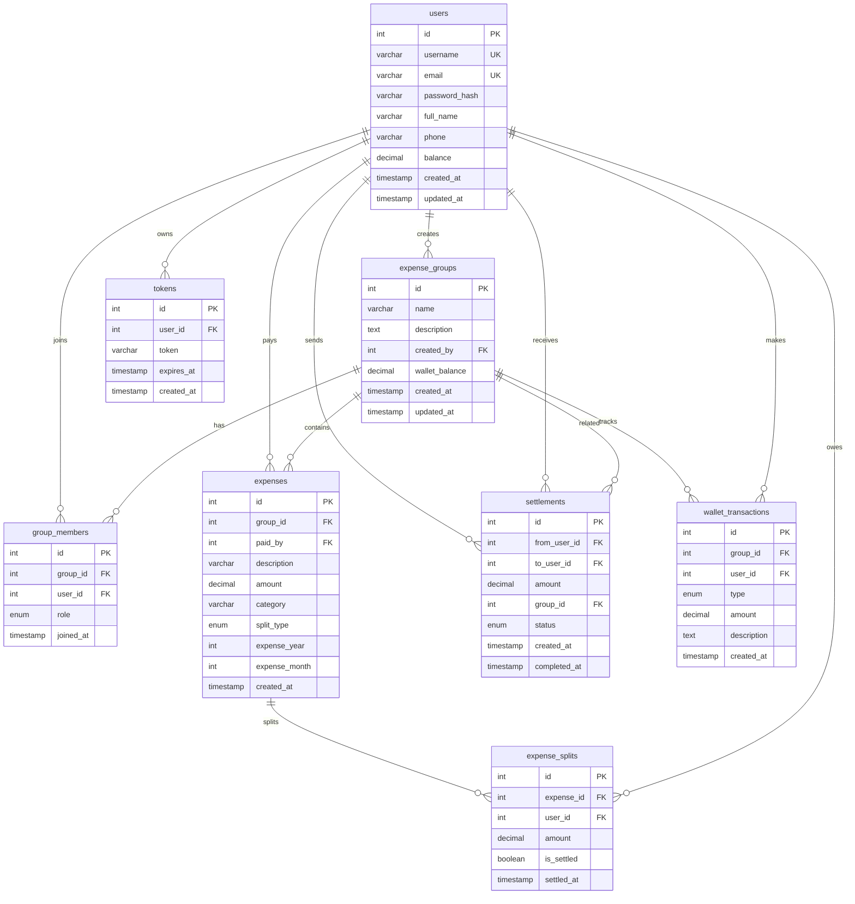
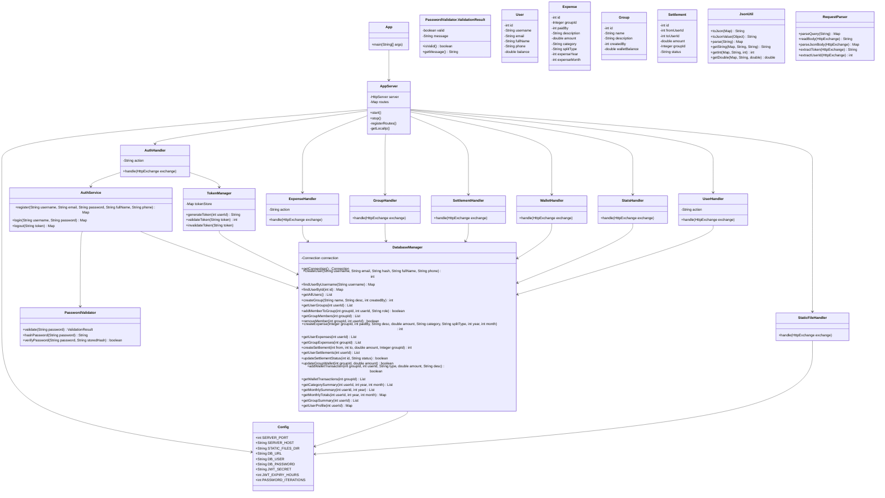

# SplitEase - Capstone Project

Full-stack Java expense splitting & group wallet application.

## Features
- JWT Authentication (Register/Login/Logout)
- Strong Password Validation (PBKDF2)
- Expense CRUD with Year/Month filtering
- Group Management with Wallet
- Settlements & Balance Tracking
- Charts & Reports (Chart.js)
- Income Tracking
- Responsive UI (Inter font, glass navbar)
- Public URL via Cloudflare Tunnel

## Tech Stack
- **Backend:** Java 21, com.sun.net.httpserver, MySQL 8.0
- **Frontend:** HTML5, CSS3, Vanilla JavaScript, Chart.js
- **Auth:** JWT tokens, PBKDF2 hashing (100K iterations)
- **Database:** MySQL with 8 tables
- **Tunnel:** Cloudflared (public URL)

## How to Run
```bash
# Compile
build.bat

# Run server
run.bat

# Run with public URL
start-public.bat
```

## ER Diagram


## Class Diagram


## Project Structure
```
expense-split-app/
├── frontend/              # UI files
│   ├── *.html             # 12 pages
│   ├── css/style.css      # Styles
│   └── js/                # 10 scripts
├── backend/               # Java server
│   ├── src/               # Source code
│   ├── bin/               # Compiled classes
│   ├── lib/               # MySQL driver
│   └── sql/schema.sql     # Database schema
├── .vscode/               # VS Code config
├── build.bat              # Compile
├── run.bat                # Run server
└── start-public.bat       # Public URL
```

## API Endpoints
| Method | Endpoint | Description |
|--------|----------|-------------|
| POST | /api/auth/register | Register user |
| POST | /api/auth/login | Login |
| POST | /api/auth/logout | Logout |
| GET | /api/users/me | Current user |
| GET | /api/users | All users |
| POST | /api/groups | Create group |
| GET | /api/groups | List groups |
| GET | /api/groups/:id | Group details |
| POST | /api/groups/:id/members | Add member |
| GET | /api/groups/:id/members | List members |
| DELETE | /api/groups/:id/members/:uid | Remove member |
| POST | /api/expenses | Create expense |
| GET | /api/expenses | List expenses |
| GET | /api/groups/:id/expenses | Group expenses |
| POST | /api/settlements | Create settlement |
| PUT | /api/settlements/:id/complete | Complete settlement |
| GET | /api/settlements | List settlements |
| POST | /api/wallet/:groupId/deposit | Deposit |
| POST | /api/wallet/:groupId/withdraw | Withdraw |
| GET | /api/wallet/:groupId/transactions | Transactions |
| GET | /api/stats/category | Category summary |
| GET | /api/stats/monthly | Monthly summary |
| GET | /api/stats/summary | Monthly totals |
| GET | /api/stats/groups | Group summary |
| GET | /api/user/profile | User profile |
